= Архитектура и инфраструктура
:toc:
:toc-title: Содержание
:sectnums:

[cols="1,3"]
|===
|Статус |Согласовано
|Дата |2026-11-08
|Связанные документы |xref:../business/requirements.adoc[Бизнес-постановка] (НФТ), xref:../adr/0001-architecture.adoc[ADR-0001], xref:../adr/0002-logging.adoc[ADR-0002], xref:screens/01-login.adoc[Экран 01. Вход через Google]
|===

Здесь собрано только то, что нужно для разработки: из чего состоит система, на чём она построена и по каким правилам работает.

== Архитектура

=== Контекст системы (C4, уровень 1)

Пользователь работает только с мобильным приложением. Вход выполняется через Google и Firebase, всё остальное приложение получает от нашего бэкенда. Бэкенд обращается к трём внешним сервисам: Firebase — для проверки отзыва токена при входе, ИИ-сервису — раз в неделю для отчётов, хранилищу бэкапов — раз в сутки.

=== Контейнеры (C4, уровень 2)

На телефоне — приложение и его зашифрованная локальная база для офлайн-режима. На сервере в Docker Compose работают четыре контейнера: Caddy принимает все входящие запросы по HTTPS, бэкенд обрабатывает API, PostgreSQL хранит данные, Dozzle показывает логи. Снаружи доступен только Caddy; база и бэкенд напрямую из интернета недоступны.

Исходники схем: `diagrams/c4-context.mmd`, `diagrams/c4-container.mmd` (Mermaid).

=== Модули бэкенда

Бэкенд — модульный монолит: один процесс, внутри — независимые модули. Монолит выбран, потому что для команды из одного-двух человек и 1000 пользователей микросервисы дают только лишнюю сложность (ADR-0001).

[cols="1,4",options="header"]
|===
|Модуль |Отвечает за
|`auth` |Проверку Firebase ID-токена, определение текущего пользователя
|`users` |Профиль, принятие документов, удаление аккаунта
|`entries` |Записи
|`moods` |Отметки настроения
|`reports` |Недельные отчёты, планировщик их формирования
|`ai` |Обращение к ИИ-сервису (адаптер, чтобы можно было сменить провайдера)
|`limits` |Бизнес-лимиты и ограничение частоты запросов
|`config` |Словарь тревожных фраз, тексты поддержки, номера линий помощи, лимиты
|`maintenance` |Удаление данных старше 12 месяцев
|===

=== Стек и технологии

Мобильное приложение:

[cols="2,3,4",options="header"]
|===
|Технология |Для чего |Почему выбрали
|Kotlin |Язык приложения |Официальный язык Android, рекомендуемый Google
|Jetpack Compose, Material 3 |Экраны и компоненты интерфейса |Современный стандарт: интерфейс пишется на Kotlin без XML-вёрстки, светлая и тёмная темы из коробки
|Room + SQLCipher |Локальная база для офлайн-режима |Room — официальная библиотека Google для базы на телефоне; SQLCipher добавляет шифрование, потому что записи очень личные
|WorkManager |Фоновая отправка записей при появлении сети |Официальный способ фоновых задач: переживает закрытие приложения и перезагрузку телефона
|Retrofit, OkHttp, kotlinx.serialization |Запросы к API и разбор JSON |Самый распространённый набор для HTTP в Android, много примеров и документации
|Credential Manager |Окно выбора Google-аккаунта |Текущий рекомендуемый Google способ входа, заменил устаревший Google Sign-In
|Firebase Authentication SDK |Вход, хранение и обновление токенов |Готовое решение: не пишем свою выдачу и обновление токенов, бесплатно на нашем объёме
|Android SpeechRecognizer |Распознавание голоса |Встроено в Android, бесплатно, голос не уходит сторонним сервисам
|Gradle |Сборка приложения |Стандартная система сборки Android, встроена в Android Studio
|===

Бэкенд:

[cols="2,3,4",options="header"]
|===
|Технология |Для чего |Почему выбрали
|Python 3.12 |Язык бэкенда |Простой для старта и отладки, лучшие библиотеки для работы с ИИ
|FastAPI |HTTP API |Быстрый и простой, сам строит документацию OpenAPI и страницу для ручной проверки методов
|Uvicorn |Сервер для FastAPI |Стандартный сервер для FastAPI
|Pydantic |Проверка тел запросов и ответов |Встроен в FastAPI: поля и ограничения из контракта описываются один раз и проверяются автоматически
|SQLAlchemy |Работа с базой из кода |Самая распространённая библиотека для баз данных в Python
|Alembic |Миграции базы |Работает вместе с SQLAlchemy; изменения структуры базы хранятся в Git и применяются одинаково везде
|psycopg |Драйвер PostgreSQL |Основной и самый надёжный драйвер PostgreSQL для Python
|firebase-admin |Проверка токенов, удаление пользователя в Firebase |Официальная библиотека Google: проверка токена — одна функция
|httpx |Запросы к ИИ-сервису |Современный HTTP-клиент с таймаутами и асинхронностью, как и FastAPI
|tenacity |Повторы при ошибках внешних сервисов |Готовые повторы с нарастающей паузой вместо самописных циклов
|APScheduler |Плановые задачи |Работает внутри бэкенда, не нужен отдельный сервис очередей (ADR-0001)
|slowapi |Ограничение частоты запросов |Готовое решение для FastAPI, не требует Redis при одном процессе
|cryptography |Шифрование текстов записей |Стандартная и проверенная библиотека шифрования для Python
|structlog |Логи в формате JSON |Удобно добавлять в каждую строку `request_id` и другие поля (ADR-0002)
|pytest |Тесты |Стандарт для тестов в Python
|===

Данные и инфраструктура:

[cols="2,3,4",options="header"]
|===
|Технология |Для чего |Почему выбрали
|PostgreSQL 16 |Основная база данных |Надёжная бесплатная реляционная база, хорошо подходит для наших связанных данных
|Docker, Docker Compose |Запуск серверных компонентов |Всё запускается одинаково на Mac и на сервере одной командой
|Caddy |Обратный прокси, HTTPS, ограничение размера запроса |Сам получает и продлевает HTTPS-сертификаты, настройка в несколько строк — проще nginx с certbot
|Dozzle |Просмотр логов в браузере |Лёгкий (10–20 МБ памяти) и бесплатный, в отличие от тяжёлых Kibana и Graylog (ADR-0002)
|age |Шифрование бэкапов |Простой современный инструмент шифрования файлов, проще GPG
|GitHub, GitHub Actions |Код, документация, тесты и деплой |Репозиторий уже там; Actions бесплатны для публичных репозиториев
|GitHub Container Registry |Хранение Docker-образов бэкенда |Бесплатно и рядом с кодом
|===

Внешние сервисы:

[cols="2,3,4",options="header"]
|===
|Сервис |Для чего |Почему выбрали
|Firebase Authentication |Вход через Google, выдача токенов |Готовый вход «под ключ», бесплатно
|GigaChat API или Yandex AI Studio |Недельные отчёты |Российские провайдеры: оплата в рублях, данные не уходят за рубеж; выбор после тестирования
|S3-совместимое хранилище в РФ |Бэкапы базы |Дёшево, хранится отдельно от сервера, данные в РФ
|VPS у российского провайдера |Сервер |Укладывается в бюджет, данные пользователей хранятся в РФ
|===

== Инфраструктура

[cols="1,4",options="header"]
|===
|Компонент |Решение
|Сервер |1 VPS у российского провайдера, 2 vCPU, 4 ГБ памяти
|Запуск |Docker Compose: caddy, backend, postgres, dozzle
|Доступ снаружи |Только порты 80 и 443 (Caddy) и SSH по ключу; вход по паролю для SSH отключён
|HTTPS |Caddy, сертификаты Let's Encrypt выпускаются и продлеваются автоматически
|Окружения |Локальное (Mac) и прод. Отдельного тестового сервера в MVP нет
|Бэкапы |`pg_dump` раз в сутки, шифрование age, отправка в S3 в РФ, хранение 30 дней
|CI/CD |GitHub Actions: при каждом pull request — тесты; при слиянии в main — сборка образа и деплой на сервер по SSH
|Логи |JSON в stdout, ротация 7 файлов по 50 МБ, просмотр в Dozzle (ADR-0002)
|===

== Политики

=== Аутентификация и авторизация

* Все методы, кроме служебной проверки работоспособности, требуют Firebase ID-токен в заголовке `Authorization`.
* Проверка отзыва токена (запрос к Firebase) — только при входе и в чувствительных операциях (удаление аккаунта). В остальных методах — проверка подписи и поиск пользователя в базе; нет пользователя — 401.
* Роль одна — пользователь. Каждый запрос работает только с данными пользователя из токена; идентификаторы чужих данных возвращают 404.
* Пока документы не приняты, доступны только вход и принятие документов.
* Подробности — в xref:screens/01-login.adoc[анализе экрана входа].

=== Ограничение частоты запросов (rate limiting)

[cols="3,2,2",options="header"]
|===
|Что ограничиваем |Лимит |Где проверяется
|Все запросы с одного IP |120 в минуту |Бэкенд (slowapi)
|`POST /api/v1/users` |10 в минуту на IP |Бэкенд (slowapi)
|Запросы авторизованного пользователя |60 в минуту на пользователя |Бэкенд (slowapi)
|Размер тела запроса |64 КБ; для пакетной синхронизации — отдельно при её анализе |Caddy
|Бизнес-лимиты: записи в сутки, длина записи, пересчёт отчёта |По бизнес-постановке (ФТ-03, ФТ-04, ФТ-09) |Бэкенд (модуль `limits`)
|===

* При превышении — `429 TOO_MANY_REQUESTS` с заголовком `Retry-After`.
* Все значения задаются в конфигурации (НФТ-11).
* Счётчики хранятся в памяти процесса. Для этого бэкенд работает в одном процессе Uvicorn — при нашей нагрузке этого достаточно. При масштабировании счётчики переносятся в Redis без изменения остального кода.

=== Чувствительные данные и шифрование

[cols="2,2,4",options="header"]
|===
|Данные |Где хранятся |Защита
|Все данные при передаче |Между телефоном и сервером, сервером и внешними сервисами |Только HTTPS (TLS 1.2 и выше)
|Тексты записей |PostgreSQL |Шифрование на уровне приложения (AES-256-GCM) перед записью в базу; ключ хранится в секретах сервера, не в базе
|Отметки настроения, отчёты, профиль |PostgreSQL |База доступна только внутри Docker-сети сервера
|Данные на телефоне |Room |Шифрование SQLCipher; ключ — в Android Keystore
|Токены на телефоне |Firebase SDK |Хранит и защищает сам SDK
|Бэкапы |S3 в РФ |Шифрование age до отправки; ключ для расшифровки хранится отдельно от сервера
|Логи |Сервер |Без персональных данных: без текстов, токенов, почты и имени
|Данные для ИИ |ИИ-сервис |Только тексты и отметки за неделю, без идентификаторов, почты и имени
|===

Сроки хранения: записи, отметки и отчёты — 12 месяцев, бэкапы — 30 дней, логи — по ротации. При удалении аккаунта данные удаляются сразу, из бэкапов — по истечении их срока.

=== Секреты

[cols="2,4",options="header"]
|===
|Секрет |Для чего
|Пароль PostgreSQL |Подключение бэкенда к базе
|Ключ шифрования записей |Шифрование и расшифровка текстов записей
|Ключ сервисного аккаунта Firebase |Проверка отзыва токенов, удаление пользователей
|Ключ API ИИ-сервиса |Запросы к ИИ
|Пароль Dozzle |Доступ к просмотру логов
|Публичный ключ age |Шифрование бэкапов (приватный ключ хранится вне сервера)
|Ключ доступа к S3 |Загрузка бэкапов
|===

* Секреты хранятся только в файле `.env` на сервере с доступом только для владельца и в секретах GitHub Actions.
* В репозитории — только `.env.example` с названиями переменных без значений.
* Потеря ключа шифрования записей означает потерю всех записей: его копия хранится отдельно от сервера.

=== Внешние вызовы и отказоустойчивость

[cols="2,1,2,3,3",options="header"]
|===
|Зависимость |Таймаут |Повторы |Circuit breaker |При отказе
|ИИ-сервис |60 с |2 повтора с паузой 5 и 30 с |Да: после 5 ошибок подряд генерация отчётов останавливается на 1 час |Отчёт помечается как неготовый и формируется позже; пользователю — «Отчёт готовится»
|Firebase (проверка отзыва при входе) |3 с |Нет |Нет |`503 SERVICE_UNAVAILABLE` (fail closed) — требует подтверждения
|Хранилище бэкапов |60 с |3 повтора |Нет |Ошибка пишется в лог; бэкап повторяется на следующий день
|===

== Нефункциональные требования

Только то, что влияет на разработку; полный список — в бизнес-постановке.

[cols="2,4",options="header"]
|===
|Требование |Значение
|Время ответа API |95% запросов быстрее 500 мс, без учёта генерации отчётов
|Доступность |Без гарантий; допустимы плановые простои при обновлениях
|Масштаб |До 1000 пользователей без смены архитектуры (НФТ-02)
|Стоимость |До 20 долларов в месяц, максимум 30 (НФТ-01)
|Объём данных для ИИ |До 15 000 символов в неделю на пользователя (НФТ-06)
|Офлайн |Записи и отметки создаются без сети (ФТ-12)
|Локализация данных |Сервер, база и бэкапы — в РФ
|===

== Открытые вопросы

* Поведение при недоступности Firebase во время входа: отказ во входе (503, сейчас) или вход без проверки отзыва.
* Выбор провайдеров: VPS, S3-хранилище, ИИ-сервис.
